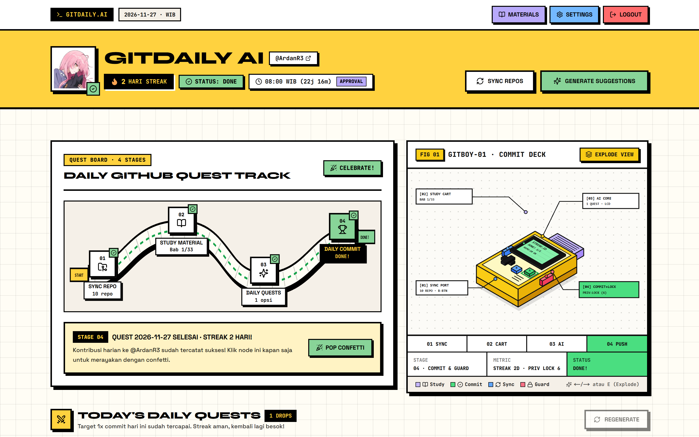
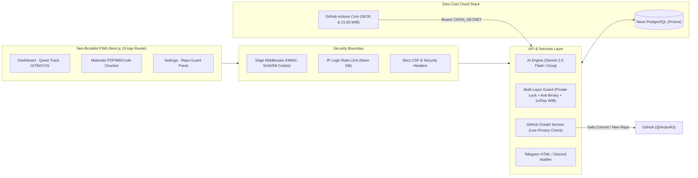
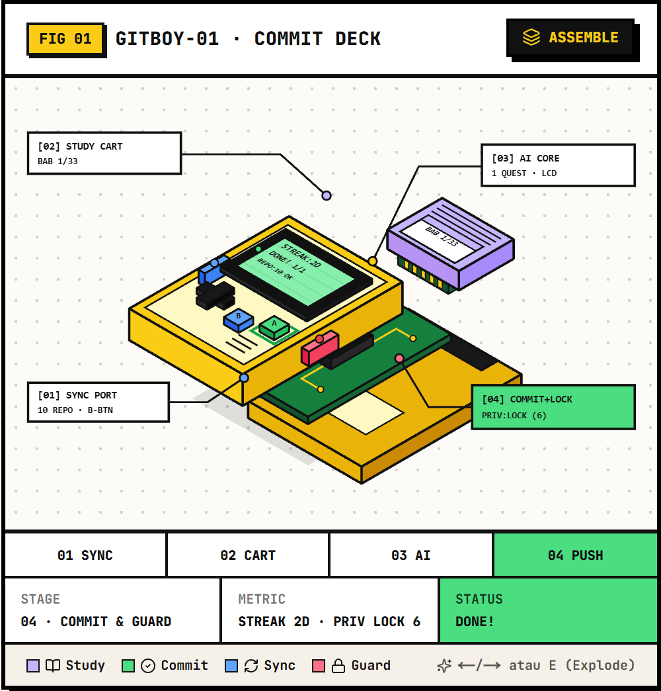

# GitDaily AI — Neo-Brutalist GitHub Quest Hub (`@ArdanR3`)

Aplikasi web full-stack **PWA-ready** bergaya **Neo-Brutalist** dengan ilustrasi anatomi isometrik interaktif **`GITBOY-01 · COMMIT DECK`** untuk menjaga konsistensi kontribusi harian GitHub secara aman, bernilai, dan **100% gratis** (Next.js App Router + Neon PostgreSQL + Prisma + Gemini/Groq AI + GitHub Actions Cron + Telegram/Discord).



---

## Arsitektur Sistem



### Interactive Anatomy — `GITBOY-01 · COMMIT DECK`

Dashboard dilengkapi komponen SVG isometrik standalone **3-layer Explode View** (`Shell`, `AI Core PCB & LCD`, dan `Study Cartridge`) yang terhubung langsung ke metrik streak, jumlah materi belajar aktif, dan status proteksi repository secara real-time.



---

## Fitur Utama & Keamanan Berlapis

| Layer | Mekanisme |
| --- | --- |
| **Multi-Layer Private Repo Guard** | Repository `isPrivate === true` dikunci permanen di 4 lapis: blokir `403` di `PATCH /api/repos/guard`, filter query AI, pengecekan `executionService`, dan *live check* langsung ke GitHub API (`octokit.repos.get`) sebelum commit. |
| **Daily WIB Guardrail** | Transaksi atomik + tabel `DailyExecutionLock` & `DailyCronLock` memastikan maksimal **1x eksekusi sukses per hari (`Asia/Jakarta`)**. |
| **Auth & Brute-Force Protection** | Cookie `HttpOnly` + `SameSite=Lax` + `Secure` bertanda tangan HMAC-SHA256, perbandingan secret *constant-time* SHA-256, serta *sliding-window IP rate limiting* (`LoginAttempt`) pada `/api/auth/login`. |
| **Prompt-Injection & File Guard** | Sanitasi tag `<untrusted_study_material>` & `<untrusted_repo_metadata>`, batas maks. 5 file / 50 KB per commit, serta blokir file biner (`.unity`, `.fbx`, `.blend`, `.png`, dll.) dan konfigurasi sensitif (`.github/`, `.env*`, `package.json`, `vercel.json`, `Dockerfile`, dll.). |
| **Study Material Chunker** | Ekstrak teks PDF (*client-side* via `pdfjs-dist`), Markdown, atau kode sumber menjadi potongan ~3.000 karakter yang diputar otomatis sebagai konteks referensi harian AI. |
| **Dual Mode & Notifikasi** | Mode `APPROVAL` (default: review & edit kode di *Code Forge Modal* sebelum push) atau `AUTOPILOT` (21:00 WIB), dengan notifikasi **Telegram (HTML-escaped)** dan **Discord Webhook**. |
| **PWA & WCAG 2.2** | Desain Neo-Brutalist responsif (`375px` mobile hingga desktop), `prefers-reduced-motion`, *focus trap* modal, dan siap di-install ke *Home Screen* Android/iOS. |

---

## Menjalankan di Lokal

1. Salin `.env.example` menjadi `.env.local` dan lengkapi kredensial (`DATABASE_URL`, `DIRECT_URL`, `GITHUB_TOKEN`, `GEMINI_API_KEY`, `DASHBOARD_PASSWORD`, `CRON_SECRET`, `TELEGRAM_BOT_TOKEN`, `TELEGRAM_CHAT_ID`):
   ```bash
   cp .env.example .env.local
   ```
2. Install dependensi dan sinkronisasi skema Prisma ke Neon PostgreSQL:
   ```bash
   npm install
   npx prisma db push
   ```
3. Jalankan server development:
   ```bash
   npm run dev
   ```
4. Buka `http://localhost:3000`, login dengan `DASHBOARD_PASSWORD`, lalu klik **Sync Repos** → **Generate Suggestions**.

---

## Deploy Gratis (Vercel Hobby + GitHub Actions)

1. Import repository ini ke [Vercel](https://vercel.com) dan masukkan seluruh environment variables dari `.env.local` (termasuk `NEXT_PUBLIC_APP_URL` dan `APP_TIMEZONE=Asia/Jakarta`).
2. Tambahkan 2 GitHub Actions Secrets di **Settings → Secrets and variables → Actions**:
   - `APP_URL`: URL production Vercel tanpa garis miring di akhir (contoh: `https://gitdaily-ai.vercel.app`)
   - `CRON_SECRET`: nilai acak yang sama persis dengan `CRON_SECRET` di Vercel.
3. Workflow `.github/workflows/gitdaily-cron.yml` akan berjalan otomatis:
   - **08:00 WIB (`01:00 UTC`)** → `POST /api/cron/daily` (sync repo, generate 2 saran, kirim notifikasi).
   - **21:00 WIB (`14:00 UTC`)** → `POST /api/cron/autopilot` (auto-push hanya jika mode `AUTOPILOT` dan belum ada push sukses hari itu).

---

## Install sebagai Aplikasi HP (PWA)

- **Android (Chrome):** Buka URL aplikasi → login → ikon menu (`⋮`) → **Install app** / **Tambahkan ke layar utama**.
- **iOS (Safari):** Buka URL aplikasi → login → tombol **Share** → **Add to Home Screen** → **Add**.
