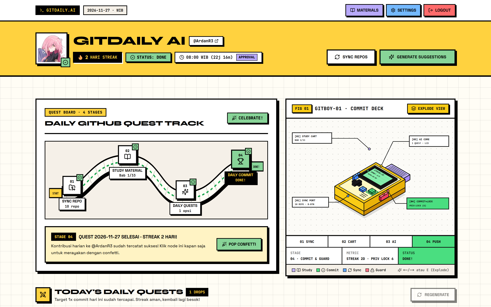
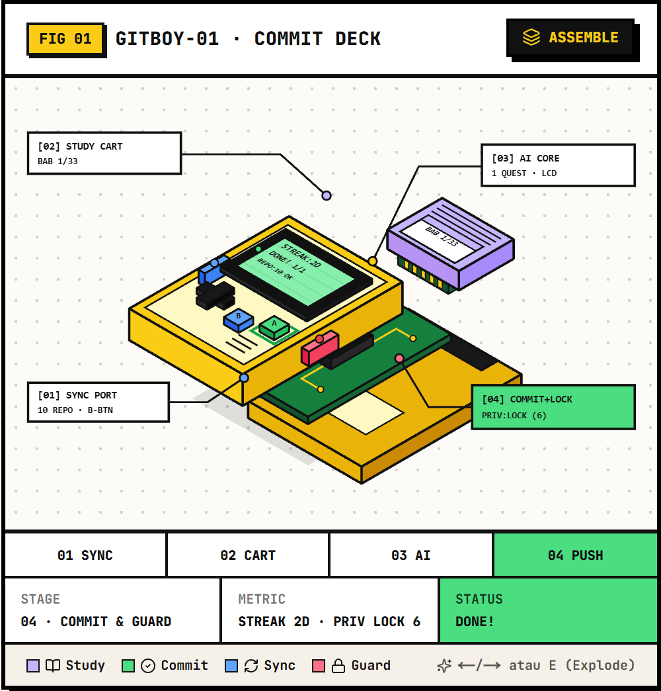
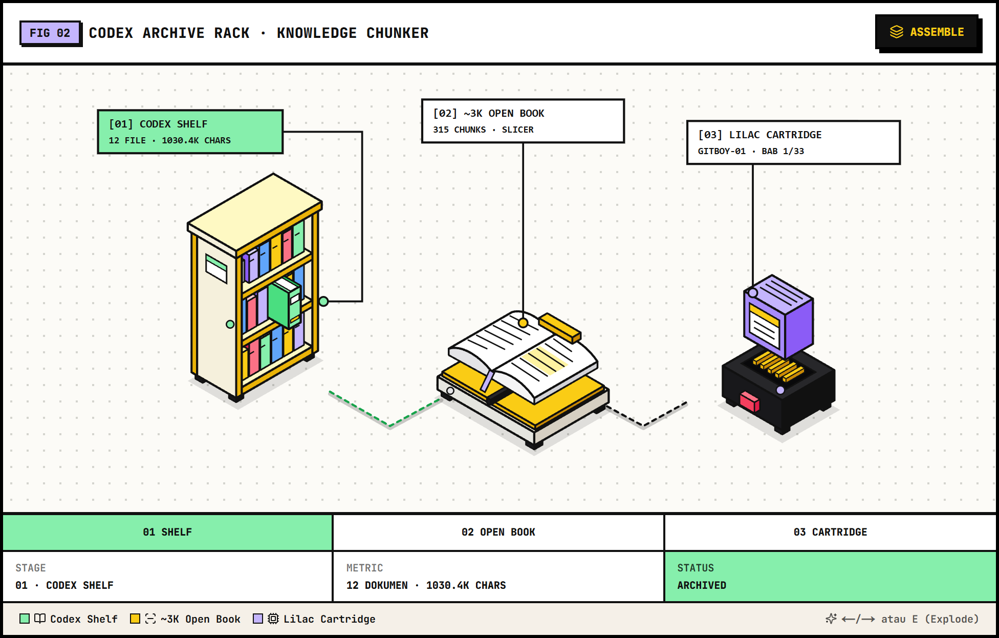

# GitDaily AI — UI Design Stack, Packages & Isometric Anatomy Guide

Panduan lengkap stack antarmuka, token desain **Neo-Brutalist**, arsitektur ilustrasi isometrik interaktif (**SVG + Framer Motion**), serta daftar **Antigravity Plugins & AI Design Skills** yang digunakan untuk membangun tampilan **GitDaily AI (*Neo-Brutalist Arcade Quest Hub*)**.

> **Konsep Visual:** Menggabungkan estetika **Neo-Brutalist** (`neubrutalism.com` inspired: border hitam tebal `2px–4px`, hard offset shadow tanpa blur, zero border-radius, palet warna kontras tinggi) dengan ilustrasi teknis isometrik bergaya instrumen bengkel/konsol retro (`GITBOY-01` & `FIG 02 · Codex Archive Rack`).

---

## 1. Visual Preview

| Dashboard Utama + `FIG 01 · GITBOY-01` | `GITBOY-01` (3-Layer Explode View) |
| :---: | :---: |
|  |  |

| `FIG 02 · Codex Archive Rack` (Explode View) |
| :---: |
|  |

---

## 2. Core NPM Packages & UI Libraries

Seluruh paket di bawah ini diambil langsung dari `package.json` proyek `gitdaily-ai`:

| Paket | Versi (`package.json`) | Link Resmi | Peran Spesifik di Antarmuka |
| --- | --- | --- | --- |
| `next` | `^15.3.0` | [GitHub](https://github.com/vercel/next.js) · [NPM](https://www.npmjs.com/package/next) | App Router, Server/Client split, `next/font/google` (`Syne`, `Space Grotesk`, `JetBrains Mono`), dan PWA metadata/viewport. |
| `react` & `react-dom` | `^19.1.0` | [GitHub](https://github.com/facebook/react) · [NPM](https://www.npmjs.com/package/react) | Runtime UI komponen interaktif, state modal, dan SVG interaktif. |
| `tailwindcss` & `@tailwindcss/postcss` | `^4.1.0` | [GitHub](https://github.com/tailwindlabs/tailwindcss) · [NPM](https://www.npmjs.com/package/tailwindcss) | Utility-first styling, responsive mobile-first (`375px` → desktop), dan `@theme inline` font tokens. |
| `framer-motion` | `^14.14.0` | [GitHub](https://github.com/motiondivision/motion) · [NPM](https://www.npmjs.com/package/framer-motion) | Transisi `AnimatePresence` modal/toast, physics `spring` pada `Explode View` SVG, dan `<MotionConfig reducedMotion="user">`. |
| `lucide-react` | `^0.511.0` | [GitHub](https://github.com/lucide-icons/lucide) · [NPM](https://www.npmjs.com/package/lucide-react) | Ikon teknis konsisten dengan ketebalan garis tegas yang menyatu dengan stroke `2px` Neo-Brutalist. |
| `canvas-confetti` | `^1.9.4` | [GitHub](https://github.com/catdad/canvas-confetti) · [NPM](https://www.npmjs.com/package/canvas-confetti) | Efek selebrasi saat misi commit harian selesai (otomatis nonaktif jika `prefers-reduced-motion: reduce`). |
| `pdfjs-dist` | `^6.5.438` | [GitHub](https://github.com/mozilla/pdf.js) · [NPM](https://www.npmjs.com/package/pdfjs-dist) | Ekstraksi teks PDF langsung di browser (*client-side*) pada halaman `/materials` sebelum dipecah menjadi chunk. |
| `@playwright/test` | `^1.65.1` | [GitHub](https://github.com/microsoft/playwright) · [NPM](https://www.npmjs.com/package/@playwright/test) | Pengujian regresi E2E, verifikasi render SVG, dan audit otomatis Mobile PWA (`375x812`). |
| `vitest` | `^5.1.2` | [GitHub](https://github.com/vitest-dev/vitest) · [NPM](https://www.npmjs.com/package/vitest) | Unit test cepat untuk guard commit, chunker materi, dan rate limiter login. |

---

## 3. Resep CSS & Design System Tokens

Seluruh token dan kelas komponen di bawah ini bersumber langsung dari `src/app/globals.css` dan `src/app/layout.tsx`:

### A. Typography Stack (`next/font/google`)
- **Display Headings (`.font-display`):** `Syne` (variable font, uppercase, `font-extrabold`, tracking rapat).
- **Body & UI Labels (`--font-sans`):** `Space Grotesk`.
- **Telemetry, Kode, Badge & SVG Callout (`--font-mono`):** `JetBrains Mono`.

### B. Palet Warna & Motion Tokens (`:root`)

```css
:root {
  color-scheme: light;
  --nb-ink: #000000;
  --nb-bg: #FFFDF5;
  --nb-bg-warm: #F5F0E8;
  --nb-surface: #FFFFFF;
  --nb-yellow: #FFD23F;
  --nb-yellow-light: #FFF3C4;
  --nb-pink: #FF6B6B;
  --nb-pink-light: #FFE0E0;
  --nb-blue: #74B9FF;
  --nb-blue-light: #E3F2FD;
  --nb-green: #88D498;
  --nb-green-light: #E8F5E9;
  --nb-orange: #FFA552;
  --nb-orange-light: #FFF0E0;
  --nb-purple: #B8A9FA;
  --nb-purple-light: #F0ECFF;
  --nb-cyan: #7FDBDA;

  --nb-shadow-sm: 3px 3px 0 0 #000000;
  --nb-shadow: 5px 5px 0 0 #000000;
  --nb-shadow-lg: 8px 8px 0 0 #000000;

  /* Motion tokens (Emil Kowalski strong ease-out) */
  --ease-out: cubic-bezier(0.23, 1, 0.32, 1);
  --dur-press: 120ms;
  --dur-ui: 180ms;
}
```

### C. Graph Paper Grid, Hard-Shadow Card & Tombol Taktil

```css
/* Latar kertas grafik Neo-Brutalist */
.nb-grid-bg {
  background-color: #FFFDF5;
  background-image:
    linear-gradient(to right, rgba(0, 0, 0, 0.08) 1px, transparent 1px),
    linear-gradient(to bottom, rgba(0, 0, 0, 0.08) 1px, transparent 1px);
  background-size: 32px 32px;
}

.nb-card {
  background-color: #FFFFFF;
  border: 3px solid #000000;
  border-radius: 0;
  box-shadow: 6px 6px 0 0 #000000;
}

/* Tombol taktil: terangkat saat hover mouse, tenggelam penuh saat ditekan */
.nb-btn {
  border: 3px solid #000000;
  border-radius: 0;
  box-shadow: 4px 4px 0 0 #000000;
  -webkit-tap-highlight-color: transparent;
  transition:
    transform var(--dur-press) var(--ease-out),
    box-shadow var(--dur-press) var(--ease-out),
    background-color var(--dur-ui) ease;
}

.nb-btn:active:not(:disabled) {
  transform: translate(4px, 4px);
  box-shadow: 0 0 0 0 #000000;
}

@media (hover: hover) and (pointer: fine) {
  .nb-btn:hover:not(:disabled) {
    transform: translate(-2px, -2px);
    box-shadow: 6px 6px 0 0 #000000;
  }
}
```

### D. Aturan Aksesibilitas, Mobile Touch & Reduced Motion
1. **Target Sentuh Minimum `44px`:** Tombol aksi memakai `min-h-[44px] sm:min-h-[34px]` agar nyaman disentuh di layar HP tanpa membuat tampilan desktop menjadi terlalu besar.
2. **Anti Auto-Zoom iOS Safari:** Semua `<input>` dan `<textarea>` menggunakan `text-base sm:text-xs` (`16px` di mobile).
3. **Keyboard Focus & Reduced Motion:**
   - `:where(button, a, input, textarea, select):focus-visible { outline: 3px solid #000000; outline-offset: 2px; }`
   - `@media (prefers-reduced-motion: reduce)` memendekkan seluruh durasi animasi CSS ke `0.01ms`, dan root aplikasi dibungkus `<MotionConfig reducedMotion="user">` di `src/components/MotionProvider.tsx`.

---

## 4. Arsitektur Ilustrasi Isometrik (`SVG + Framer Motion`)

Alih-alih memuat *engine* 3D WebGL/Three.js yang berat di bundle dan boros baterai HP, GitDaily AI menggambar ilustrasi interaktif menggunakan **proyeksi isometrik 30° murni di atas SVG vektor** + **`framer-motion` spring**.

### Mengapa Pendekatan Ini Lebih Unggul untuk Dashboard & PWA?
1. **Zero Bundle Bloat & Tajam di Semua DPI:** Semua garis tinta `#111111` dan teks monospace tetap tajam di layar retina `2x`/`3x` tanpa *antialiasing* buram atau GPU context loss.
2. **Matematika Proyeksi Ringkas:** Fungsi `iso(x, y, z)` mengubah koordinat 3D ke 2D dalam beberapa baris (`cos 30° = 0.8660254`, `sin 30° = 0.5`), lalu helper `IsoBox` merender 3 sisi tampak (*top*, *right*, *left*) dengan *painter's order* dan shading 3–4 nada.
3. **60fps Tanpa Idle Loop:** Tidak ada `requestAnimationFrame` yang berputar terus-menerus saat idle. Animasi hanya aktif saat pengguna melakukan *hover*, klik *stage*, menekan panah `←`/`→`, atau menekan toggle **`EXPLODE VIEW`** (shortcut `E`).
4. **Terhubung Langsung ke Telemetry Real-Time:** `GITBOY-01` (`src/components/figures/gitboy-deck/GitBoyDeckFigure.tsx`) dan `FIG 02 · Codex Archive Rack` (`src/components/figures/knowledge-chunker/KnowledgeChunkerFigure.tsx`) membaca data nyata dari Neon DB (jumlah repo, streak, materi aktif, dan posisi `BAB X/Y`).

---

## 5. Daftar Antigravity Plugins & AI Design Skills

Daftar plugin dan skill lokal yang berperan langsung membentuk tampilan, animasi, dan kualitas kode UI GitDaily AI *(tautan sumber hanya dicantumkan jika tersedia pada metadata lokal)*:

### A. Isometric Technical Anatomy
| Nama | Sumber | Peran di GitDaily AI |
| --- | --- | --- |
| `anatomy` | Antigravity Skill Lokal | Merancang `FIG 01 · GITBOY-01` dan `FIG 02 · Codex Archive Rack` sebagai objek fisik mekanis (bukan sekadar kotak panah abstrak), dengan *dot-grid* `#fcfbf7`, shading multi-nada, *leader lines*, dan 3-layer `Explode View`. |

### B. Motion & Tactile Physics
| Nama | Sumber | Peran di GitDaily AI |
| --- | --- | --- |
| `emil-design-eng` | Antigravity Skill Lokal | Menentukan kurva `--ease-out: cubic-bezier(0.23, 1, 0.32, 1)`, durasi cepat `120ms–200ms`, animasi masuk modal (`scale(0.98) -> 1`), dan menjaga interaksi tetap taktil. |
| `improve-animations` | Antigravity Skill Lokal | Mengaudit seluruh komponen animasi agar patuh `prefers-reduced-motion` (`MotionProvider`), membungkus modal dengan `AnimatePresence`, dan menghapus animasi idle yang tidak perlu. |
| `better-motion` | Antigravity Skill Lokal | Menjaga konsistensi durasi, *easing*, serta membatasi animasi hanya pada transisi bermakna. |
| `apple-design` | Antigravity Skill Lokal | Memberikan prinsip *interruptible spring transitions* dan konsistensi fisik saat komponen ditekan/digeser. |

### C. UI/UX, Design System & Anti-AI-Slop
| Nama | Sumber | Peran di GitDaily AI |
| --- | --- | --- |
| `antislop` (`antislop-ui`, `antislop-layoutmobile`, `antislop-code`, `antislop-copywriting`, `antislop-human`) | [github.com/miqdadbadjuber/anti-slop](https://github.com/miqdadbadjuber/anti-slop) · [antislop.ai.id](https://antislop.ai.id) | Menghilangkan tampilan "template AI generik", membersihkan komentar banner/slop di kode, menajamkan copy UI Neo-Brutalist, dan memastikan reflow mobile bersih. |
| `impeccable` (`adapt`) | Antigravity Skill Lokal | Audit adaptasi antar-device (desktop padat vs mobile sentuh `375px`) dan penghapusan dialog `window.confirm()` bawaan browser. |
| `better-interface` & `interface-review` | Antigravity Skill Lokal | Audit menyeluruh per layar dan per *diff* untuk mencegah regresi tata letak, kontras, dan aksesibilitas. |
| `better-ui`, `better-layout`, `better-colors`, `better-typography`, `better-accessibility` | Antigravity Skill Lokal | Penyetelan kontras WCAG 2.2, hierarki ukuran font (`Syne` + `Space Grotesk` + `JetBrains Mono`), `min-w-0` anti-overflow, serta *focus trap* dialog. |
| `ui-ux-pro-max` & `frontend-design` | Antigravity Skill Lokal | Menentukan arah estetika awal (*Neo-Brutalist Arcade Quest Hub*) agar konsisten dari `/login`, `/`, `/materials`, hingga `/settings`. |

### D. Runtime & Mobile PWA Verification
| Nama | Sumber | Peran di GitDaily AI |
| --- | --- | --- |
| `webapp-testing` | Antigravity Skill Lokal (Playwright) | Menjalankan `tests/e2e/regression.spec.ts` secara otomatis untuk menguji redirect auth, Security Guard `403`, render `FIG 01`/`FIG 02`, serta audit `375x812` (`0` overflow, input `>= 16px`, tombol `>= 44px`). |
| `chrome-devtools-plugin` (`a11y-debugging`) | [github.com/ChromeDevTools/chrome-devtools-mcp](https://github.com/ChromeDevTools/chrome-devtools-mcp) | Referensi audit aksesibilitas semantik HTML, ARIA label, focus state, dan tap target. |

---

## 6. Workflow Step-by-Step Membuat UI Serupa dari Nol

Jika ingin mereplikasi pendekatan ini di proyek Next.js lain, ikuti urutan berikut:

1. **Tetapkan Arah Visual & Design Tokens (`globals.css` + `layout.tsx`):**
   - Pilih 1 identitas tegas (di sini: Neo-Brutalist + kertas grafik `#FFFDF5`), definisikan variabel warna kontras tinggi, font display/body/mono, dan kelas dasar `.nb-card`, `.nb-btn`, `.nb-input`.
2. **Bangun Layout & Komponen dengan Prinsip Anti-Slop (`antislop-ui` + `better-layout`):**
   - Hindari *glassmorphism* generik atau gradien berlebih; pakai hierarki warna fungsional (mis. kuning untuk aksi utama/header, ungu untuk materi, hijau untuk status sukses, merah untuk lock/bahaya).
3. **Tambahkan Ilustrasi Anatomi Isometrik (`anatomy` + `SVG + Framer Motion`):**
   - Petakan alur sistem ke objek fisik nyata (konsol/rak buku), buat fungsi proyeksi `iso(x, y, z)` dan primitif `IsoBox`, tambahkan *leader lines* anti-tabrakan, lalu hubungkan ke telemetri state nyata.
4. **Poles Micro-Interaction & Motion (`emil-design-eng` + `improve-animations`):**
   - Terapkan `cubic-bezier(0.23, 1, 0.32, 1)` untuk respons tekan tombol, bungkus modal/toast dengan `AnimatePresence`, dan pasang `<MotionConfig reducedMotion="user">`.
5. **Audit Aksesibilitas & Mobile PWA (`impeccable/adapt` + `webapp-testing`):**
   - Kunci aturan `text-base sm:text-xs` pada input, `min-h-[44px] sm:min-h-[34px]` pada tombol aksi, `overscroll-contain` & *focus trap* pada modal, lalu otomatiskan pengecekan di viewport `375x812` lewat Playwright.
